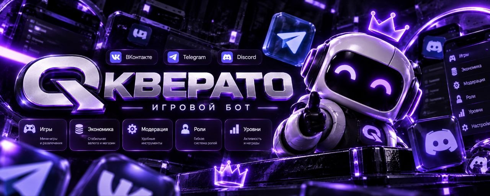

  
  <h1>👑 КВЕРАТО</h1>
  
<b>Многопользовательский игровой бот для ВКонтакте, Telegram и Discord</b>

  
Экономика • Кланы • Дуэли • Недвижимость • Бизнесы • Достижения • Рейтинги

  
VK v1.0 · Telegram v1.0 · Discord v1.0

---

## О проекте

**КВЕРАТО** — игровая вселенная с виртуальными монетами, персонажами, бизнесами, имуществом, кланами и соревнованиями. Участники зарабатывают игровую валюту, прокачивают профиль, соревнуются и открывают достижения.

Все три платформы поддерживают самостоятельную работу. **Балансы и игровые базы между ними автоматически не синхронизируются.**

## Три версии

| Платформа | Релиз | Исходный код |
|---|---|---|
| ВКонтакте | 1.0 | [bots/vk](bots/vk) |
| Telegram | 1.0 | [bots/telegram](bots/telegram) |
| Discord | 1.0 | [bots/discord](bots/discord) |

Архивы первоначального релиза v1.0 оставлены в корне репозитория как неизменённые исходные поставки. Для новой разработки используются файлы в папке **bots/**.

## Установка и запуск (Windows)

1. Установите **Python 3.12**.
2. Откройте папку нужной платформы в **bots/**.
3. Скопируйте файл **.env.example** в **.env**, впишите токен и числовой ID владельца.
4. Запустите соответствующий **install_*_windows.bat**, затем **start_*.bat**.
5. Для длительной работы предусмотрен отдельный **start_*_24x7.bat**.

Для каждой платформы используется собственная SQLite-база. При обновлении переносите сохранения из своей предыдущей сборки, предварительно сделав резервную копию.

**Никогда не публикуйте токены, файлы .env, базы игроков или резервные копии.**

## Разработка и проверка

В GitHub Actions настроена проверка целостности трёх релизов, соответствия общего ZIP и синтаксиса Python. Импорт исходников из релизных архивов выполняется однократно и **не перезаписывает изменённые файлы**.

Команды локальной проверки:

~~~bash
python tools/release_audit.py
python -m compileall -q bots
~~~

Изменения игровых механик следует проверять на тестовой базе и в API соответствующей платформы перед выпуском обновления.

## Безопасность

- .env и игровые SQLite-базы игнорируются Git.
- Виртуальные монеты и имущество не являются реальными средствами.
- Старые официальные ZIP не изменяются при разработке нового кода.

© КВЕРАТО · Официальный релиз 1.0
