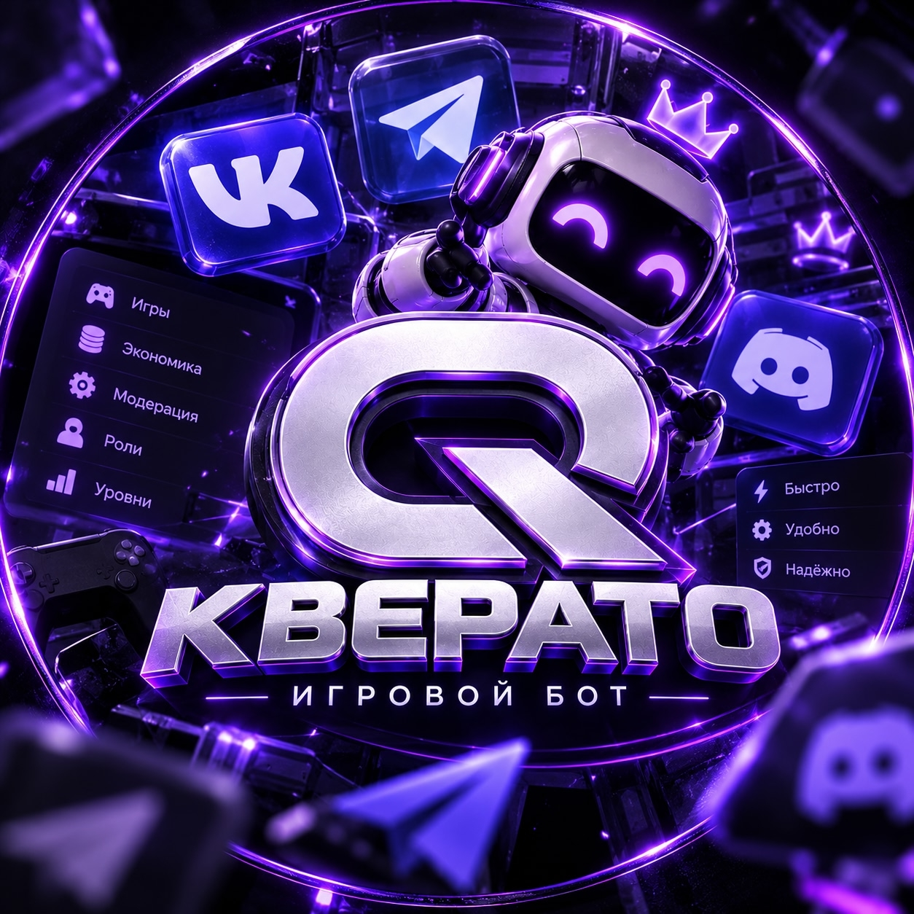

# КВЕРАТО

**Игровая вселенная прямо в твоём чате.**

Развивай персонажа, зарабатывай монеты, создавай клан и поднимайся в рейтингах — во ВКонтакте, Telegram или Discord.

  
  
  

**[Скачать](#скачать)** · **[Возможности](#возможности)** · **[Запуск](#быстрый-запуск)** · **[Исходники](#исходный-код)** · **[Помощь](#помощь-и-документация)**

---

## О проекте

**КВЕРАТО** — многопользовательский игровой бот с виртуальной экономикой и социальными механиками. Игра работает прямо в сообщениях: отдельный клиент или сайт не нужен.

Зарабатывай игровую валюту, собирай имущество, открывай бизнесы, развивай персонажа, участвуй в дуэлях и соревнуйся с другими игроками.

> **Три платформы — три самостоятельных мира.** VK, Telegram и Discord используют общие игровые принципы, но каждый бот работает со своей SQLite-базой. Прогресс и балансы автоматически не объединяются.

## Скачать

Первый официальный релиз — **КВЕРАТО 1.0**. Можно установить одну платформу или скачать полный комплект.

| Версия | Архив | Исходники |
| :-- | :-- | :-- |
| **ВКонтакте** | [Скачать VK 1.0](releases/v1.0/KVERATO-VK-v1.0-FINAL.zip) | [bots/vk](bots/vk) |
| **Telegram** | [Скачать Telegram 1.0](releases/v1.0/KVERATO-TG-v1.0-FINAL.zip) | [bots/telegram](bots/telegram) |
| **Discord** | [Скачать Discord 1.0](releases/v1.0/KVERATO-DISCORD-v1.0-FINAL.zip) | [bots/discord](bots/discord) |
| **Полный комплект** | **[Скачать все три версии](releases/v1.0/KVERATO-v1.0-FULL-RELEASE.zip)** | Три независимых бота |

Архивы первого релиза **1.0** оставлены без изменений. В папке [bots](bots) ведётся разработка **1.1.0-dev.6** (тестовая версия, ещё не новый релиз).

## Возможности

| Раздел | Что доступно |
| :-- | :-- |
| **Персонаж** | Профиль, опыт, уровни и статистика |
| **Экономика** | Монеты, бонусы, переводы, цели накопления и приватная выписка с фильтрами и страницами в 1.1-dev |
| **Имущество** | Транспорт, дома, бизнесы и покупки |
| **Социальные системы** | Кланы, взаимодействие игроков и репутация |
| **Соревнования** | Дуэли, развлечения, турниры и рейтинги |
| **Прогресс** | Достижения и сезонные активности |
| **Управление** | Административные команды с проверкой ID владельца |

Набор команд и кнопок отличается в зависимости от платформы. Подробнее — [в описании возможностей](docs/FEATURES.md).

## Три платформы

<table>
  <tr>
    <td width="33%" align="center">
      <h3>ВКонтакте</h3>
      
Игровые команды в сообщениях сообщества и графические карточки.

      <a href="bots/vk"><b>Исходники VK</b></a>
    </td>
    <td width="34%" align="center">
      <h3>Telegram</h3>
      
Личные настройки, команды, кнопочные меню и взаимодействия игроков.

      <a href="bots/telegram"><b>Исходники Telegram</b></a>
    </td>
    <td width="33%" align="center">
      <h3>Discord</h3>
      
Slash-команды, карточки, кнопки и игровые механики на серверах.

      <a href="bots/discord"><b>Исходники Discord</b></a>
    </td>
  </tr>
</table>

  
  
Фирменный стиль: тёмная графика, фиолетовые акценты и стеклянные игровые карточки.

## Быстрый запуск

Для Windows рекомендуется **Python 3.12**. У каждой версии собственный токен и база данных.

1. Скачай архив платформы или клонируй репозиторий.
2. Открой нужную папку: <code>bots/vk</code>, <code>bots/telegram</code> или <code>bots/discord</code>.
3. Создай <code>.env</code> из <code>.env.example</code>, заполни токен и ID владельца.
4. Запусти установщик зависимостей и стартовый BAT-файл:

| Платформа | Установка | Запуск |
| :-- | :-- | :-- |
| VK | <code>install_vk_windows.bat</code> | <code>start_vk.bat</code> |
| Telegram | <code>install_tg_windows.bat</code> | <code>start_tg.bat</code> |
| Discord | <code>install_discord_windows.bat</code> | <code>start_discord.bat</code> |

Для длительной работы предусмотрены отдельные запускатели <code>start_*_24x7.bat</code>. Не запускай два экземпляра одного бота с одной базой.

**[Подробная инструкция по установке и обновлению](docs/INSTALLATION.md)**

## Исходный код

~~~text
Kverato/
├── bots/
│   ├── vk/              VK API и сообщения сообщества
│   ├── telegram/        Telegram Bot API
│   └── discord/         Discord Gateway и slash-команды
├── branding/            Фирменная графика
├── docs/                Документация и планы
├── releases/v1.0/       Оригинальные архивы релиза
├── tools/               Проверки без токенов
└── .github/             CI и шаблоны обращений
~~~

Игровое ядро пока присутствует в трёх независимых копиях. Его объединение потребует проверки совместимости команд и сохранений.

### Проверка перед изменениями

~~~powershell
python tools/release_audit.py
python tools/core_smoke.py
python tools/weekly_smoke.py
python tools/rewards_smoke.py
python tools/goals_smoke.py
python tools/economy_regression.py
python tools/statement_pagination_smoke.py
python tools/upgrade_from_v1_smoke.py
python tools/check_docs_links.py
python -m compileall -q bots
~~~

GitHub Actions проверяет исходники, архивы, основные игровые операции на временных SQLite-базах и отсутствие известных приватных файлов в Git. Это не заменяет живого тестирования платформенных API.

## Помощь и документация

| Документ | Содержание |
| :-- | :-- |
| [Установка и обновление](docs/INSTALLATION.md) | Как запустить бота и сохранить прогресс |
| [Возможности](docs/FEATURES.md) | Основные игровые механики |
| [Частые вопросы](docs/FAQ.md) | Токены, команды, SQLite, исправление ошибок |
| [План развития](docs/ROADMAP.md) | Над чем планируется работа |
| [Безопасное обновление с 1.0](docs/UPGRADING_V1.md) | Копии, миграция и проверка базы |
| [История изменений](CHANGELOG.md) | Релиз 1.0 и текущая разработка |
| [Контрольный список релиза](docs/RELEASE_CHECKLIST.md) | Безопасный выпуск новых версий |
| [Архитектура](docs/ARCHITECTURE.md) | Структура исходников |
| [Участие в разработке](CONTRIBUTING.md) | Как предложить изменения |
| [Безопасность](SECURITY.md) | Как сообщить об уязвимости |

**Нашёл ошибку или хочешь предложить функцию?** [Создай обращение в Issues](https://github.com/Zeihos/Kverato/issues/new/choose).

> **Безопасность:** не публикуй токены, <code>.env</code>, базы SQLite и резервные копии. При обновлении сначала останови бота и сохрани данные. Игровые монеты не являются реальными деньгами.

---

**КВЕРАТО · VK / Telegram / Discord**

Первый официальный релиз — **1.0**

Проект <a href="https://github.com/Zeihos">Zeihos</a>

